# Mermaid 语法大全（2026 版）：用文本画图，跟 AI 一起做设计

:::note[本文为 AIGC 生成内容]
本文由 AI 根据 Mermaid 官方文档整理生成，示例语法已对照官方文档核对，人工审校后发布。Mermaid 版本更新较快，beta 类型的图语法可能变化，请以官方文档为准。
:::

## 前言

最近跟 AI 对话做方案、画架构的时候，发现一个很顺手的东西：Mermaid。

以前画图得打开专业工具，一个个拖框连线；现在直接用几行文本描述，AI 就能帮你生成、修改流程图、时序图、甘特图，贴到文档里就能渲染出来。跟 AI 讨论设计时，也不用再截图、不用再描述“那个框框”——直接贴一段 Mermaid 代码，AI 读得懂、改得了，来回几轮设计就定下来了。

这篇是按 2026 年最新语法（Mermaid 12.3）写的一份速查：覆盖常用的图类型，示例都可以直接复制使用。适合当作随手查的手册，花半小时过一遍，以后不管是写方案、画架构，还是跟 AI 一起做设计，都能省不少事。

## Mermaid 是什么

Mermaid 是一个开源的 JavaScript 图表库：用人类可读的纯文本描述，就能生成流程图、时序图、类图、甘特图等各种图表。图本身就是文本——可以放进 Git 仓库做版本管理，可以贴进 Markdown 文档，可以直接发给 AI 阅读和修改。

它解决的是“画图太麻烦”的问题：不用学专业绘图工具，不用拖拽对齐，写几行文本，图就出来了。改图也不用重新画，改几行文本就行。

## 版本说明

本文基于当前稳定版 Mermaid 12.3.0（2026 年 11 月发布），v13 还是 alpha，只适合尝鲜，别用到生产文档里。

- 关键字：新图一律写 flowchart。graph 是老写法，还能用，是为了兼容；但新功能（比如子图方向、新形状语法）只认 flowchart。
- 画风：v12 默认用 ELK 布局和 neo 外观，类图和状态图会重新排版、换配色。语法没变，同一份代码在新版里样子会不一样。想保留老样子，在图前面加一段 front matter 配置（见“样式与主题”一节）。
- 新图类型：XY 图、块图、桑基图、数据包图、架构图、AI 智能体流程图、看板图、雷达图，在新版里都可以用。
- 形状语法：可以用 A@{ shape: stadium } 这种写法，一个节点可以指定几十种形状，不用再死记括号的含义。

## 能画什么

- 流程图 flowchart：流程、算法、决策树、架构概览
- 时序图 sequenceDiagram：接口调用、服务间消息往来
- 类图 classDiagram：面向对象结构、数据模型
- 状态图 stateDiagram-v2：生命周期、状态机
- ER 图 erDiagram：数据库表关系
- 甘特图 gantt：项目排期
- 饼图 pie：占比
- 思维导图 mindmap：发散、整理思路
- 时间线 timeline：按时间讲故事
- 用户旅程 journey：用户体验路径
- 象限图 quadrantChart：四象限分析
- Git 图 gitGraph：分支演进
- XY 图 xychart-beta：柱状图、折线图
- 架构图 architecture-beta：云架构、服务关系
- 桑基图 sankey-beta：流量、转化漏斗
- 看板 kanban：任务看板
- 块图 block-beta：方块布局图
- AI 智能体流程图 agentflow-beta：多智能体协作流程

## 安装与使用

- 浏览器里直接用：引入 CDN 上的 v12，再初始化一次。

```html
<script src="https://cdn.jsdelivr.net/npm/mermaid@12/dist/mermaid.min.js"></script>
<script>mermaid.initialize({ startOnLoad: true });</script>
```

- Node.js 项目里用：

```bash
npm install mermaid
```

- Markdown 里用：围栏代码块写 mermaid，GitHub、GitLab、Notion、Obsidian 都能原生渲染；VS 2026 起在 Markdown 里也内置了渲染。
- 在线试：Mermaid Live Editor（mermaid.live），边写边看，适合调语法。
- 导出：渲染出来的图可以导出 SVG、PNG，贴进文档和 PPT 都行。

## 语法速查

每种图下面先给代码、再讲要点；本站会把 Mermaid 代码直接渲染成图，示例都可以直接复制使用。

### 流程图

最常用的一种。第一行声明方向：LR 从左到右，TD 从上到下。

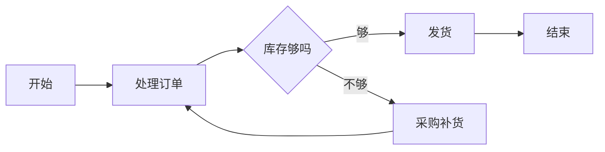

- 节点形状：方括号是矩形，圆括号是圆角，菱形花括号是判断，圆形双括号是起止点。
- 连线：--> 是实线箭头，-.-> 是虚线，==> 是粗线；--文本--> 可以在连线上写字。
- 11.3 起可以用新形状语法：A@{ shape: stadium }，形状名有几十种，旧括号写法照样能用。
- 子图用 subgraph ... end 包起来，可以给一组节点分组，也可以单独指定方向。

### 时序图

描述对象之间随时间传递的消息，画接口调用最合适。

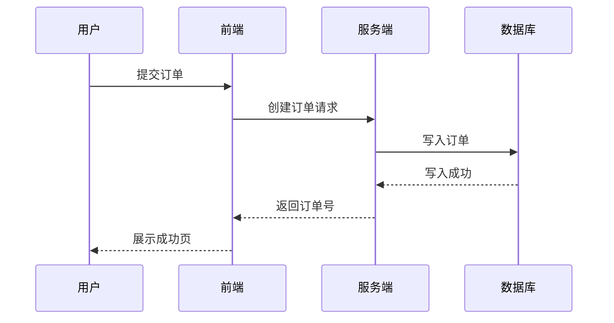

- ->> 是实线请求，-->> 是虚线返回；-> 和 --> 是不带箭头的版本。
- participant 可以起别名；11.12 起还支持 actor、database、queue 等参与者类型。
- loop、alt、opt 可以表示循环和分支；Note over 可以加注释。
- 注意：消息文本里不要带分号，分号会被当成语句结束符，会报解析错误。

### 类图

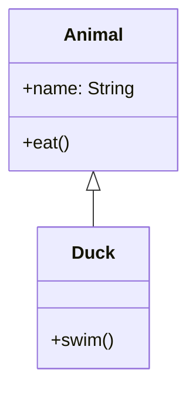

- + 是公开，- 是私有，# 是受保护；冒号后面写类型，括号表示方法。
- 关系：<|-- 是继承，*-- 是组合，o-- 是聚合，-- 是关联，.. 是依赖。
- 类图在 v12 里换了 ELK 布局和 neo 外观，排版会和老版本不一样。

### 状态图

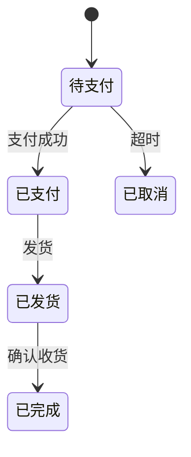

- [*] 表示开始和结束；--> 是状态转移，冒号后面写触发事件。
- state 可以定义复合状态，note 可以给状态加说明。

### ER 图

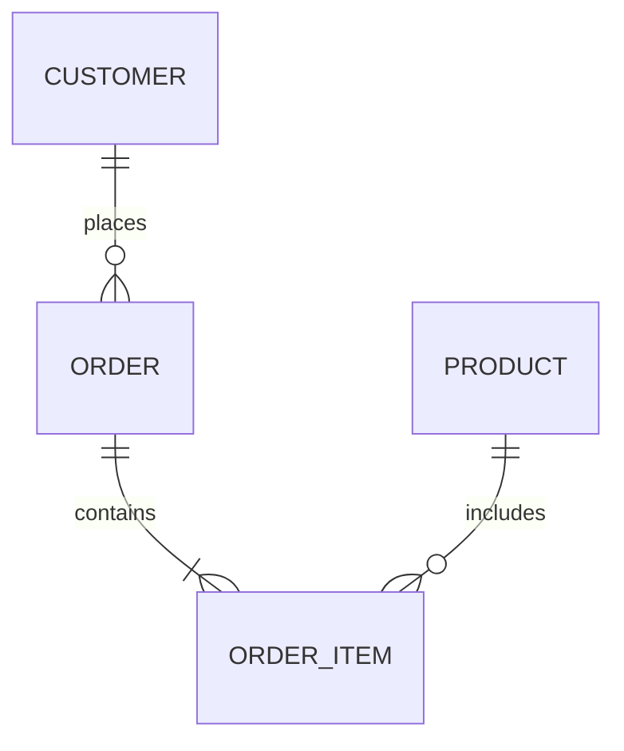

- ||--o{ 这类符号表示一对多、多对多等基数关系；竖线是“一”，o 是“零”，{ 是“多”。
- 画数据库表关系、讲清楚外键时最省事。

### 甘特图

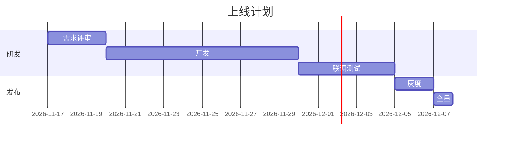

- title、dateFormat、section 是固定写法；任务用“名字 :id, 开始时间, 持续时间”，after 表示接在某个任务之后。
- 排期、里程碑、版本计划都适合用它。

### 饼图

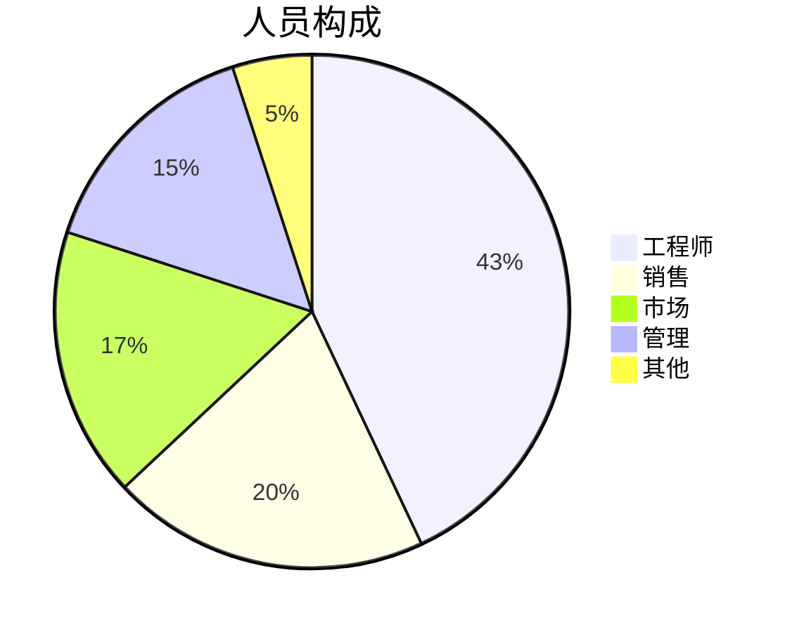

- pie 开头，title 写标题；每一行是“标签 : 数值”，标签建议加引号。

### 思维导图

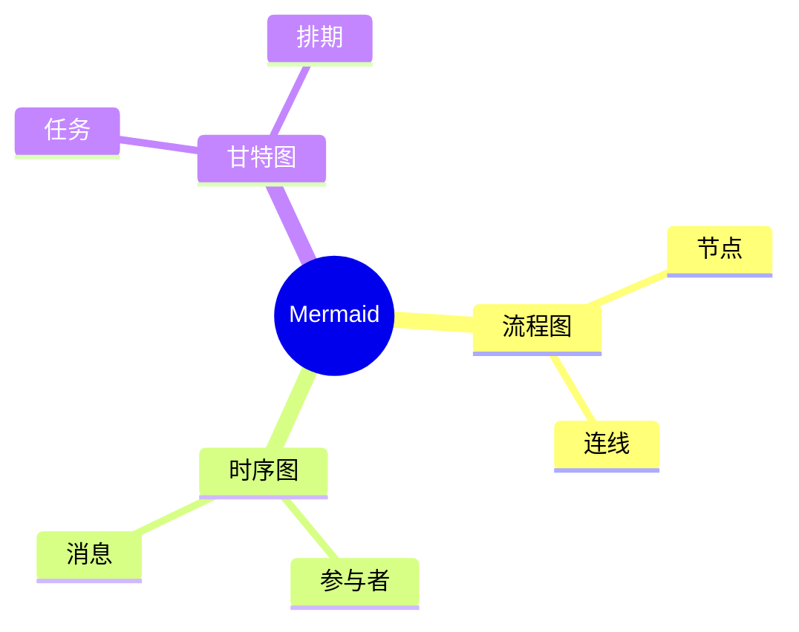

- root 是根节点，缩进表示层级；括号形状和流程图类似。
- 整理思路、开会记录、知识梳理时很好用。

### 时间线

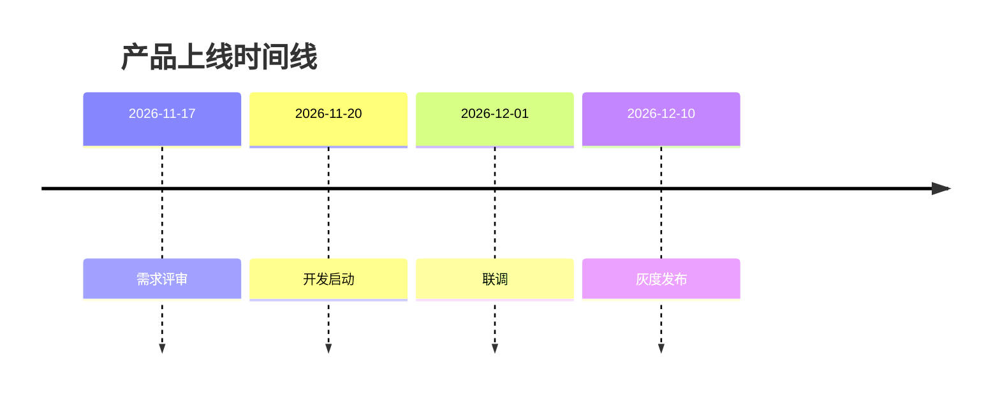

- 按时间讲故事：版本历史、项目里程碑、事件复盘都适合。

### 用户旅程

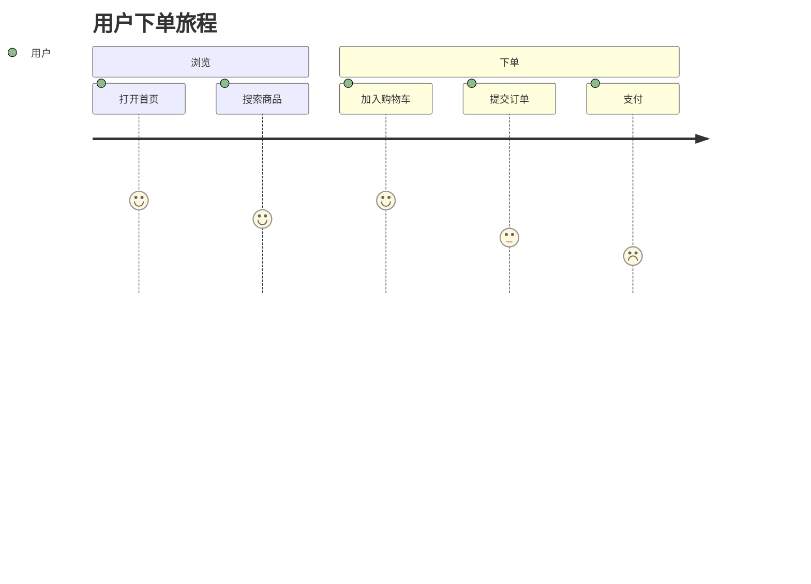

- 每一行是“任务 : 评分 : 角色”，评分 1 到 5；section 分段。
- 讲用户体验、找体验短板时用。

### 象限图

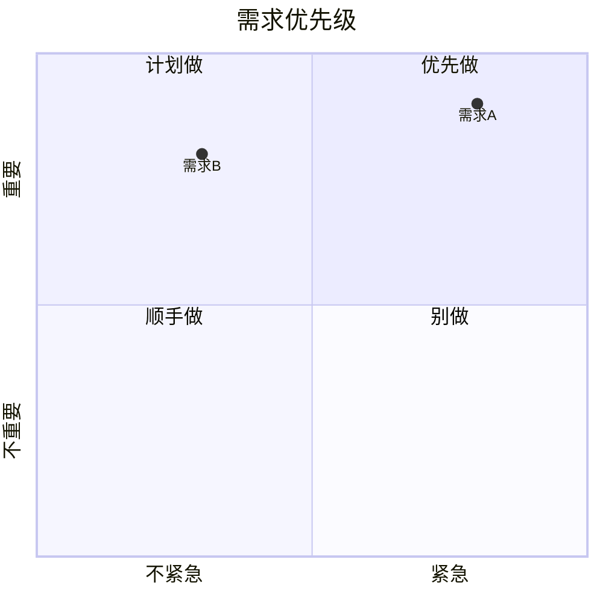

- 四象限分析：优先级排序、技术选型对比都适合。

### Git 图

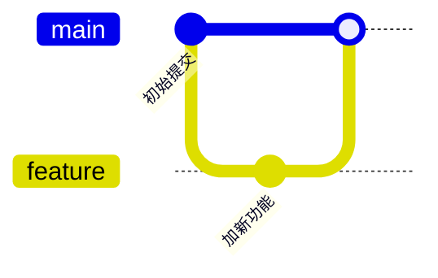

- commit、branch、checkout、merge 四个命令就能画分支演进；讲发版流程、分支策略时很直观。

### XY 图

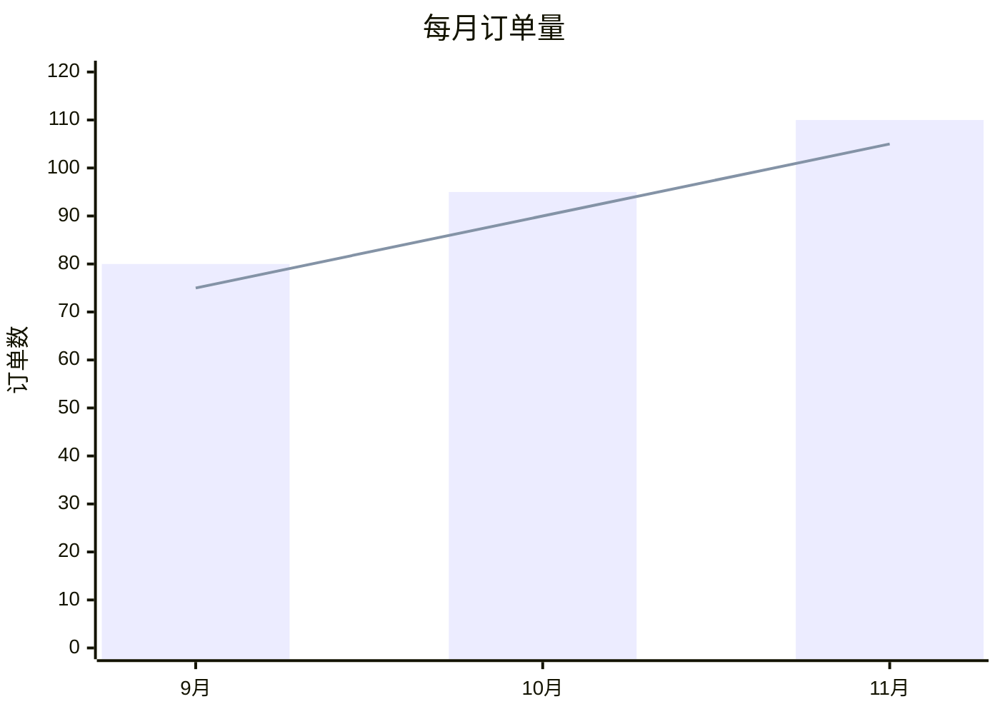

- 柱状图、折线图都能画；名字还带 -beta，在旧渲染器上可能显示不出来。

### 架构图


- group 分组，service 定义服务（括号里是图标类型），in 表示属于哪个组；连线用 :R、:L、:T、:B 指定从哪边出、哪边进。
- 画云架构、服务依赖关系时比流程图更贴切；还是 beta，语法可能还会变。

### 桑基图

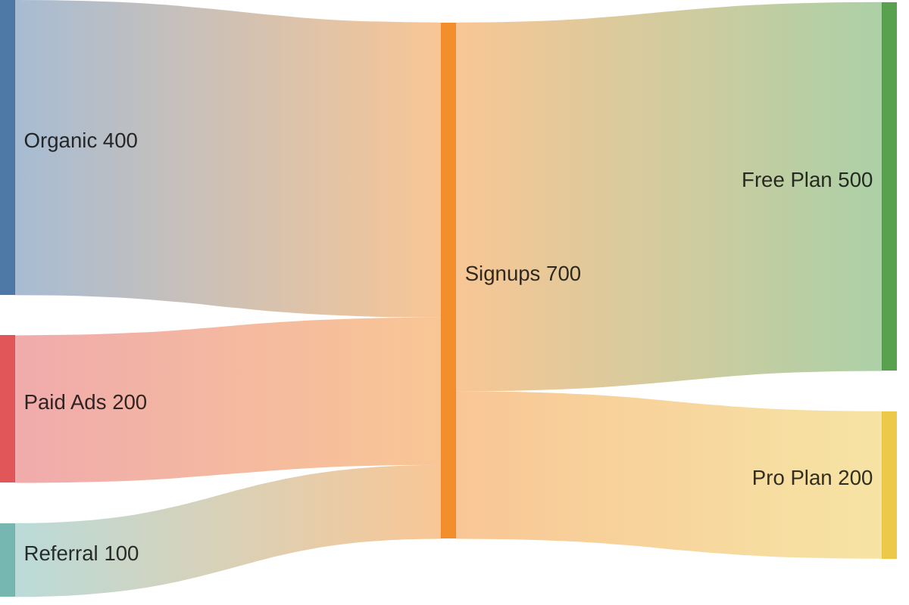

- 每一行是“来源,目标,数值”，画流量、转化漏斗最直观；也是 beta。
- 注意：桑基图的节点名目前不支持中文，这是 Mermaid 解析器的限制（中文节点名会报解析错误），所以上面这段示例用英文标注：Organic 是自然流量，Signups 是注册，Free Plan / Pro Plan 是免费版 / 付费版。

### 看板

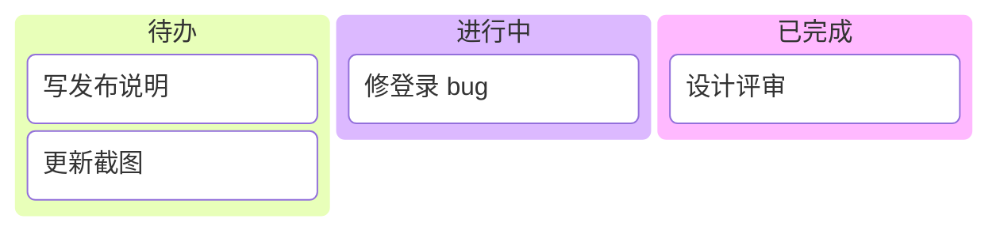

- 第一层是列，第二层是卡片；每个卡片要有唯一 ID。
- 卡片后面可以加 @{ assigned: '张三', priority: 'High' } 写负责人和优先级。
- 任务挪动就是把一行换个位置，适合放在项目文档里当轻量看板。

### 块图

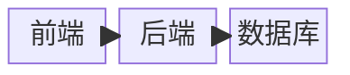

- columns 指定每行几个方块；节点写法和流程图类似；适合画简单的分层、并排结构。

## 样式与主题

- 主题在初始化时配：mermaid.initialize({ theme: 'default' })，可选 default、dark、forest、neutral、base，以及 v12 的新外观 neo。
- 想给单个图指定配置，用 front matter 写在图的最前面：

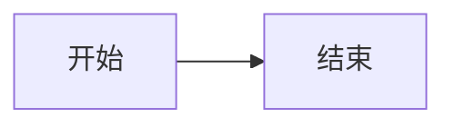

- 上面这段配置的意思是：用回老配色、老外观、老布局。升级 v12 后如果觉得图的样子变陌生了，就用它恢复。
- 节点样式用 style：style A fill:#BEE7E9,stroke:#333,stroke-width:2px；classDef 可以一次定义一组样式复用。

## 跟 AI 一起用 Mermaid

这是 Mermaid 在 AI 时代真正值钱的地方——图是文本，AI 天生就能读写它：

- 让 AI 生成：把需求用文字描述清楚，让 AI 直接输出 Mermaid 代码，你贴到支持渲染的地方就能看效果。改需求不用重画，让 AI 改代码就行。
- 让 AI 改图：把现有代码贴回去，说一句“把审批节点改成并行”，AI 改完你再渲染确认。
- 让 AI 读图：评审别人的设计时，把 Mermaid 代码贴给 AI，让它帮你找缺失的分支、走不通的路径、不合理的依赖。
- 图进仓库：图和代码放同一个仓库，改设计就是改文本，git diff 看得一清二楚，评审时直接在代码上评论。

注意：不同工具内置的 Mermaid 版本不一样，名字带 -beta 的图在旧渲染器上可能显示不出来；发给同事之前，先确认对方那边的渲染环境支不支持。

## 常见坑

- 时序图里消息文本不要带分号：A->>B: total ; tax 会报解析错误，因为分号在 Mermaid 里是语句结束符。改成逗号或者拆成两条消息。
- 节点文字里不要直接写括号：在 GitHub 这类渲染器上，标签里的括号容易导致解析失败；要么用引号把文字包起来，要么把括号改成中文括号。
- graph 和 flowchart：老教程写 graph，新功能只认 flowchart，新图一律写 flowchart。
- 升级 v12 后图的样子变了：正常，是 ELK 布局加 neo 新外观；要老样子用前面那段 front matter 配回去。
- beta 图类型：名字带 -beta 的还在试验阶段，语法可能变，重要文档里慎用。
- 版本：写文档时顺手注明一句“基于 Mermaid 12.3”，别人复现时少踩很多坑。

## 总结

Mermaid 的核心就一句话：图也是文本。文本能进版本库、能被搜索、能被 AI 读写，这才是它在 AI 时代真正值钱的地方。

不用一次全学会。先记住 flowchart、sequenceDiagram、gantt 这三个最常用的，剩下的当字典查。等你开始用 Mermaid 跟 AI 一起讨论设计，就会发现以前“画图”这件事，本身就是一道不必要的工序。

参考：

- Mermaid 官方文档 https://mermaid.js.org
- Mermaid Live Editor https://mermaid.live
- GitHub Releases https://github.com/mermaid-js/mermaid/releases
